<p align="center">
  
</p>

<h1 align="center">Remi</h1>

<p align="center">
  Turn scanned and AI-generated meshes into lighter, textured assets—in Blender or in the cloud.
</p>

<p align="center">
  <a href="https://remi3d.app"><strong>Try Remi Cloud</strong></a>
  · <a href="https://github.com/shaderko/remi-blender-addon/releases/latest"><strong>Download Blender add-on</strong></a>
  · <a href="#quick-start">Quick start</a>
  · <a href="#tool-guide">Tool guide</a>
  · <a href="https://github.com/shaderko/remi-blender-addon/issues">Report an issue</a>
</p>

## Remi Cloud

[**Open remi3d.app →**](https://remi3d.app)

Optimize a GLB in your browser, or queue a batch and come back for the results.
Remi Cloud remeshes, simplifies, unwraps, and rebakes your models on cloud workers,
with a 3D preview, processing progress, and downloadable outputs. No Blender
installation is needed.

1. Create an account and verify your email. You get **10 free credits**.
2. Upload a GLB or add several models to a batch. Choose the detail, triangle
   target, and texture size, then start optimization.
3. Follow the progress or return later to preview and download your results.

**One full optimization costs one credit.** Monthly plans add more credits;
uploaded models and results remain available for 30 days after processing.
The Blender add-on remains free and open source for local work and manual tools.

## What Remi does

| Need | Tool |
|---|---|
| Generate images and 3D sources | **Remi Board** with local Iris-3B and separate image/3D/mesh cards |
| Process a model end to end | Preset-driven **Run Full Flow** |
| Recover without scene duplicates | Single-mesh sessions with **Back**, **Redo**, and **Start** |
| Close holes, cracks, or fragmented surfaces | Manual patches, Boundary, Hybrid, Alpha-Guided, or Closing Volume repair |
| Rebuild a surface | Voxel Remesh or Closing Volume |
| Reduce triangles | Multi-pass MeshLab decimation |
| Create guided quads | Native Interactive Instant Meshes |
| Run automatic quad retopology | Optional AutoRemesher integration |
| Build production UVs | Validated charting, repair, and xatlas packing |
| Transfer source appearance | Albedo, roughness, normal, and AO baking |
| Project splats from the current view | **Texture** workspace: lasso area, hideable view layers with rendered Gaussian normals, optional 3D base |
| Separate fused parts or doubled shells | Edit Mode selection tools |

## Install

### Automatic retopology guides (development)

Interactive retopology now also offers opt-in **Automatic Feature Guides** for
circular rims, cylindrical flow, and reliable curvature directions, plus true
closed-loop manual guides and a measured ordinary/guided preview comparison.
See [automatic Instant Meshes guidance](docs/instant_meshes_guidance.md).

### Model generation beta

The asset-board workflow is available as **2.7.0-beta.7**, separately from the
stable release. It includes the installable board, isolated Blender mesh editing,
image-to-splats generation, mesh reconstruction, and texture baking. This is a **prerelease**, not a
replacement for the stable release. Back up your `.blend` files before testing.
See [beta release notes and setup](docs/releases/2.7.0-beta.7.md).

### Local image and 3D generation (beta)

The **Remi Board** combines local text-to-image with **Iris-3B** and
**Iris-3B Turbo** and 3D generation as separate linked cards. Downloadable
weights and generation settings live under the board's gear; the composer and
image uploads are on the canvas. Select an image to generate a separate 3D
source, with progress on its card. Iris is text-to-image only; reference-image
conditioning is not supported. Turbo needs about 15 GB on disk (6 GB model +
9 GB Qwen text encoder), runs on a 12 GB CUDA GPU in low-memory mode, and is
much faster than the 12 GB base model. See
[local image generation](docs/iris_image_generation.md).

**Target version:** Blender **5.3** with native Gaussian rendering. Blender 5.1
and 5.2 are not supported by this build. This beta ships a **Windows x64** ZIP,
validated with Blender 5.3 beta. Other platforms are not validated or distributed
for this beta.

1. Download the `windows-x64` ZIP from [GitHub Releases](https://github.com/shaderko/remi-blender-addon/releases).
2. In Blender, open **Edit → Preferences → Get Extensions**.
3. Open the top-right menu, choose **Install from Disk**, and select the ZIP.
4. Make sure **Remi** is enabled. In the 3D Viewport, press `N`, open **Remi**,
   and click **Open Remi Board**. You can also use **Remi Board** in the viewport
   header, **View → Open Remi Board**, or press `F3` and search **Open Remi Board**.

The package includes MeshLab, Alpha Wrap, native Instant Meshes, and the UV
backend. Do not unzip it or install a second copy in Blender's legacy
`scripts/addons` directory. **No `.bat`, Python launch script, or development
checkout is needed.** Start Blender normally after installing. Enabling Remi
does not open a board, change your workspace, or start a job automatically.
Save Blender's preferences if automatic preference saving is disabled. Save
your `.blend` with the board open to restore that workspace when reopening it.
Optional AI generation still needs the external CUDA/PyTorch environment and
downloaded models described in the setup guides; configure their paths from
the board's settings gear.

### Docked generation workspace

Click **Remi Board** in the 3D Viewport header to open the image/3D
board beside a Blender viewport in the **same window**. The original workspace
is left untouched. Switch Blender's workspace tabs freely; queued generations
continue while the board is hidden. Hover the board and press **Ctrl+Space**
to maximize or restore it. Double-click an image to inspect it in place, then
press **Esc** to return.

The Remi sidebar has the **Open Remi Board** launcher and the optional
**Optimize** / **Texture** tools; the old Generate tab is removed.
Mesh-edit **Apply to Card** / **Back to Board** controls stay in
the viewport header, not the sidebar. Native Undo/Redo reattaches the existing
board host and input handler without resetting cards or queued jobs. The header
launcher can reopen or repair the board if its editor/workspace is lost.

The board keeps **Image → 3D source → Mesh → processed version** as separate,
linked assets. Automatic results appear beside their sources; source files are preserved. Generation
and mesh/flow jobs do not import hidden objects into the working scene.
**Add to Scene** imports an asset only when requested. Mesh flows reuse Remi's
automatic presets in an isolated local Blender worker and produce a portable
GLB. Interactive drawing/retopology tools still use their native 3D workspace.

The **fixed left toolbar** has no panel background. From top to bottom:
**Generate 3D**, **Create Mesh**, **Run Remi Flow**, **Texture Mesh**,
**Edit in Blender**, **Add to Scene**, **Add Images**, **Export Asset**, and
**Cancel Job**. Icons stay in place and enable for the current selection:
Image → Generate 3D, 3D source → Create Mesh, Mesh → Run Remi Flow.
Hover an icon for its name and any unavailable-action explanation.

**Left-click runs immediately with the saved settings. Right-click** Generate
3D, Create Mesh, Run Remi Flow, or Texture Mesh to configure its defaults without
starting a job—even when that action is disabled. Defaults are saved in the
`.blend`; each queued job keeps its own settings snapshot. Generation settings
are locked while a generation is active. Texture Mesh uses an explicit appearance
link or the mesh's original 3D-source lineage.

The bottom composer always offers **Create Image**; the selection strip shows
thumbnails and status, not changing action buttons. Right-click a card for
secondary actions: **Copy Prompt / Use Prompt**, **Reset Preview to Front**,
**Job Files**, and error **Details**, where applicable.

### Edit a mesh in ordinary Blender

1. Select a completed **Mesh** card and click **Edit in Blender**. Each card gets
   its own scene with independent mesh/material data, in a normal **Mesh Editor**
   workspace. Your main scene, its objects, and its original layout stay intact.
2. Work normally: Blender Undo/Redo, Edit Mode, sculpting, UVs, materials,
   modifiers, and adding or splitting mesh parts. No Remi session or automatic
   flow starts. The existing Remi sidebar tools remain available if you want them;
   the Gaussian appearance source is inferred from the card's links/lineage.
3. Click **Apply to Card** in the viewport header. The **same card** updates,
   retaining its identity, position, and connections. A fresh GLB contains the
   mesh parts, evaluated modifiers, UVs, and GLB-compatible material textures.
   Earlier files are retained as backups; already-placed objects in your main
   scene are not replaced. An export failure leaves the card and edit intact.
4. **Back to Board** returns to your original scene without applying/discarding
   the edit. Reopen the card to resume its scene, including editable modifiers.
   Save the `.blend` to retain these editing scenes across restarts; keep the
   source/output folders as well. Only **Apply to Card** updates the board file.

The board is an asset library and automatic-job launcher, not a replacement for
the native editing tools. **Add to Scene** remains a separate action. Automatic
**Run Remi Flow** is available in the fixed toolbar and the mesh's right-click menu.

3D source cards use Blender 5.3's **native Gaussian renderer**, with the complete
data. **Mesh cards have the same interactive in-card viewport**, showing their
mesh parts, vertex colors, materials, and embedded textures. Both use temporary
isolated scenes; orbiting never adds objects to your working scene or starts an
editing session. No custom splat shader or ellipsoid preview is used.
**Alt-drag any 3D source or Mesh card** to orbit;
**Reset Preview to Front** in the card menu resets its view. Idle cards use captured PNG thumbnails, including
after reopening the board. Native previews load only on orbit, stay warm for
**30 seconds after interaction**, and are capped at **3 loaded previews**.
The least recently used preview is unloaded first. Neither drawing a thumbnail
nor dragging a card extends that timer; the last captured view stays visible.
Live orbit reuses its native scene and GPU target instead of rebuilding them
every frame. Thumbnail decoding/capture pauses during board navigation, and
idle cards do not continuously redraw. Preview scenes are discarded before saving.

### Drop a 3D source onto a mesh to texture it

There is a playful shortcut: **drag the body of a 3D source card onto a Mesh
card**. The mesh lights up with **Release to texture**, and the splat becomes a
small lifted thumbnail so you can still see the target.

Release to queue the existing local texture bake immediately, using the current
Texture settings. A new **Textured Mesh** card shows travelling colored splats,
a scanning mesh preview, an orbital loader, and real worker status. A short
completion burst plays only when the bake succeeds. Albedo and normals are
embedded together in the GLB; missing UVs are created automatically.

- The splat returns to its original board position. Neither source card/file,
  the mesh's existing appearance link, nor your Blender working scene is changed.
- **Ctrl-drag** moves/overlaps cards without baking; **Esc** cancels the highlighted
  drop. Group moves, orbiting, and drops outside a ready mesh do not trigger it.
- Repeating an identical drop while its bake is queued/running selects the
  existing result instead of launching a duplicate. **Cancel** remains available.
- The effect uses cached thumbnails and lightweight 2D graphics, not extra live
  Gaussian renderers. It stops when the job ends and does not animate while hidden.

For explicit settings, the existing graph-style option is still available:
drag a 3D card's **right-edge handle** onto a mesh to link appearance without
starting a job, then use **Texture Mesh** in the toolbar or right-click the mesh →
**Create Textured Mesh**. Use **Unlink 3D
Texture Source** to remove that optional link. **Add to Scene** remains separate.

**Board controls:** left-click a card to select it; left-drag to move the selected
cards together. Left-drag empty space for box selection (**Shift** adds,
**Ctrl** subtracts). **Middle-drag anywhere** pans the board without moving cards.
Use the wheel to zoom and **Alt-left-drag** a 3D source or Mesh card to orbit its preview.
Press **F** to frame the board. Drop one or more image files directly onto the
canvas to add them. **X** / **Delete**, or right-click → **Delete Selected Cards
and Files**, deletes the whole selection after one confirmation. Unselected
versions and original uploaded files are kept; files shared with unselected
cards are not deleted. Right-click also offers export. Existing
generation files are recovered through their source-image metadata.

Keep the generation/output folders: the board stores file references, asset
identities, settings, and lineage, not a packed copy of every artifact in the
`.blend`. Jobs continue across workspace switches; interrupted jobs are not
silently replayed after loading a file or restarting Blender. Compute is local;
the file-in/file-out job boundary is prepared for a later cloud runner.

For development, `scripts/run-ui-sketch.bat` opens this workspace directly.
The board is part of the installable extension, not a separate application.

The Windows sketch launcher uses a separate profile under
`%LOCALAPPDATA%\Remi\ui-sketch`, with **Tablet API → Windows Ink**. This avoids
a roughly 36-second startup timeout observed with an unresponsive Wacom/WinTab
driver. It does not change normal Blender preferences or GPU settings. If
regular Blender has the same delay, try **Preferences → Input → Tablet →
Tablet API → Windows Ink** and save preferences. WinTab-specific tablet
behavior may differ; this is a development-launcher workaround, not an add-on
setting forced on customers.

## Quick start

### Experimental: image to Gaussian splats

Open **Remi Board** from the viewport header to generate with the local
`rand6_100_ncm` model. This uses an external CUDA/PyTorch environment, saves
native Gaussian-splat PLY files, and imports lossless splat data with a
**native Gaussian point cloud on Blender 5.3**. **Create Mesh** requires Blender
5.3 with the `remi-splat-mesh` backend in the external Python environment.
It reconstructs a vertex-colored opacity iso-surface from the Gaussian data.
**Dense** uses a 512³ field; **Fast** uses 256³. No separate surface executable
is required. **Create Mesh** adds a separate mesh card without changing the
working scene or automatically reducing geometry. Each 3D card
keeps its own result; multiple models in one file are supported without an
archive cache. This is a
lossy approximation of the splats, not a native splat render. The external
generation worker keeps its model warm for 5 minutes by default; adjust this in
the generation gear or set it to 0 to reload every run. See
[setup and usage](docs/image_generation.md). Native rendering is tested on
Blender 5.3 beta. Runtime paths
and advanced controls live in the gear menu. Choose **Optimize** for the
existing mesh workflow.

### Experimental: project splats from the current view

After **Create Mesh** and Remi cleanup, switch to **Texture**. Keep the low-poly
mesh active and clear any drawn area, then **Bake Whole Mesh · Octree** to match
and alpha-composite local Gaussian layers into color, normal, and confidence maps.
Conservative source-depth estimates supply normal detail where reliable, with a
clean-geometry fallback instead of density-shell normals. Check alignment and
**Maximum Source Gap**; inspect unmatched regions in Confidence. This does not
restore geometry or silhouette lost through extreme simplification.

For view-specific layers, click
**Draw Area** and drag a loop around the region you want on the model, then
click **Project from View**. Remi renders the linked splats from that camera and
projects that view only inside the drawn region, as a layer. Move the view and
repeat; each projection is a separate layer that can be hidden, faded, or
deleted.

The projection is matched in screen space through the viewport camera, so the
mesh and splat objects do not need matching origins. Each view layer can also
include a normal map rendered from the same visible Gaussians. Projection runs
in an external Python process; the Generate Python environment must provide
`numpy`, `scipy`, and `Pillow`. **Project 3D** remains available for an
unmasked full-surface base.

See [texture projection](docs/texture_projection.md) for the view workflow,
layers, settings, and limitations.

### Automatic: remesh to baked asset

1. Select one mesh in **Object Mode**.
2. Open **N-panel → Remi**.
3. Choose **Default · Remesh to Bake**.
4. Click **Run Full Flow**.

```text
Voxel Remesh → MeshLab Decimation → UV Unwrap → Bake All Maps
```

Remi checks dependencies before changing the mesh. Success leaves one finished
result. Failure stops before later stages and opens the last valid result as a
manual session; use **Back**, **Finish**, or **Cancel Session** from there.

### Manual: use only what the mesh needs

1. Select one mesh in **Object Mode** and click **Start Remi**.
2. Choose **Repair**, **Remesh**, **Retopology**, **UV**, or **Bake**.
3. Run an operation. Remi commits it only after success.
4. Click **Finish** to keep the result or **Cancel Session** to restore the source.

## Choose the right tool

| Problem | Start with | Key trade-off |
|---|---|---|
| General cleanup | **Voxel Remesh** | Fast; rebuilds the surface and may soften detail |
| Cracks and fragmented geometry | **Closing Volume** | More complete; slower and memory-heavy |
| One visible hole | **Draw Around Hole** | Precise local repair; requires a short surface stroke |
| Clear topology holes | **Boundary** | Preserves more geometry; does not bridge spatial gaps |
| Holes plus narrow cracks | **Hybrid** | More aggressive than Boundary |
| Difficult scan or AI fragments | **Alpha-Guided Patches** | Uses bundled MeshLab Alpha Wrap |
| Fewer triangles | **MeshLab Decimation** | Included in Remi |
| Artist-guided quads | **Interactive Retopology** | Target count is approximate |
| Automatic quads | **AutoRemesher** | Requires an external executable |
| UVs only | **Generate UV** | Existing marked seams can be preserved |
| Source textures on a new mesh | **Bake All Maps** | Uses Cycles and the original source checkpoint |

## Session safety

Remi locks one visible mesh for the active session. Operations run on temporary
candidates; a failed operation does not replace the current mesh.

| Control | Result |
|---|---|
| **Back** | Previous committed mesh |
| **Redo** | Reverted mesh |
| **Start** | Original source |
| **Finish** | Keep the current result and leave Remi |
| **Cancel Session** | Restore the source and leave Remi |

Recovery checkpoints are temporary session data, not crash-persistent project
history. Save the `.blend` file normally and keep source assets until the result
has been reviewed.

## Tool guide

<details>
<summary><strong>Full Flow and presets</strong></summary>

The built-in flow uses a `0.01` voxel size, six `50%` decimation passes (about
`1.56%` retained before topology limits), 2048 px textures, and a 4 px UV gap.
These are starting points, not universal settings.

- Click the pencil beside a preset to load it into **Current Settings**.
- Enable only the stages you need; use each stage's settings button to edit it.
- Save the current stages and settings as a reusable preset.
- Saving an existing name requires **Replace**. The built-in default cannot be deleted.
- **Stop After Current Stage** or `Esc` stops at the next stage boundary.

Interactive drawing and guided Instant Meshes are manual-only. Custom automatic
flows may include Repair or external AutoRemesher when their dependencies exist.

</details>

<details>
<summary><strong>Repair and remesh</strong></summary>

- **Draw Around Hole:** draw on intact visible surface around one hole; release to apply.
- **Boundary:** caps bounded topology loops.
- **Hybrid:** combines boundary filling with narrow-crack repair.
- **Alpha-Guided Patches:** uses bundled MeshLab Alpha Wrap as a guide for missing regions.
- **Volume-Guided Patches:** borrows only gap-spanning faces from a fine closing-volume guide.
- **Closing Volume:** closes spatial gaps, then fits the result toward source surfaces and creases.
- **Voxel Remesh:** fast, general surface consolidation.
- **Surface Offset:** use `0` to follow the sampled surface, or `1` to expand it
  by one voxel and consolidate thin or open geometry.

Lower voxel sizes retain more detail and consume more memory. Start coarse, then
reduce the value only when the silhouette needs it.

For decimation, set **Target Triangles** for an absolute target, or leave it at
`0` to use the per-pass percentage. Absolute targets use measured triangle
counts and multiple passes, reducing by at most 50% per pass; topology
constraints can prevent reaching the target.

</details>

<details>
<summary><strong>Interactive Instant Meshes</strong></summary>

1. Open **Retopology**, set an approximate target, and click **Start Interactive Retopology**.
2. Draw an **Orientation Comb** to steer flow or an **Output Edge** to guide an extracted edge.
3. Change **Target Faces** to re-solve without restarting the workspace.
4. Use **Dim Original**, **Retopo Offset**, and **Face Fill** to read the preview.
5. Click **Accept Retopology** or **Cancel Retopology**.

The preview can report topology warnings and remain acceptable. Treat warnings
as review prompts: inspect holes, components, and shading before accepting.

</details>

<details>
<summary><strong>UV</strong></summary>

Remi classifies the mesh, builds several chart candidates, repairs local invalid
regions, packs with xatlas, and keeps the best valid result within its distortion
and density limits.

- Choose a profile and the texture size used to measure spacing.
- **Gap** is edge-to-edge distance: `4 px` means four pixels across the gap.
- **Preserve Marked Seams** keeps artist seams as chart boundaries.
- The result reports chart count, 95th-percentile stretch, occupied area, overlaps, and gap.
- A failed UV operation restores the previous UVs and seams.

Validation establishes the measured checks; it does not guarantee optimal
packing or a fixed occupancy percentage for every mesh.

</details>

<details>
<summary><strong>Baking</strong></summary>

Remi bakes from the original source checkpoint onto the current result. Use
**Bake All Maps** or bake albedo, roughness, tangent-space normal, and AO separately.

- **Auto Unwrap** keeps a valid UV map and regenerates a missing or invalid one.
- **Auto Cage & Ray** derives distances from the source-to-target gap.
- **Half Scale** temporarily scales both bake meshes together, then restores them.
- **Recalc Normals** is off by default to preserve the UV-prepared target's normals.
- Baked images are Blender data; pack or save them before closing the file.
- Enable **Include Metallic** when the source uses a metallic factor or map.

</details>

<details>
<summary><strong>Texture projection</strong></summary>

The **Texture** workspace projects the linked splats onto the active mesh.
Click **Draw Area** and drag a loop around the region that should receive the
next projection. Then **Project from View** renders the splats from the current
viewport camera and projects that view only inside the drawn region, as a layer.
Add several views around the object, then hide, fade, or delete layers in the
Layers panel. The material is rebuilt from the visible layers. With **Normal
Map** enabled, Remi renders a second pass of the same Gaussians with their
covariance normals and stores a tangent-space normal map on each view layer;
normal layers composite over an existing or 3D-projected base normal.

**Project 3D** is optional: it samples the Gaussian field at every UV texel for
a full-surface base, tangent-space normal, and confidence map. It does not rely
on a viewport camera. The drawn area applies to
view layers, not the 3D bake.

- View projection requires Blender 5.3+ native Gaussian rendering.
- Projection runs in the external Python configured in the **Remi Board** gear and needs
  `numpy`, `scipy`, and `Pillow`.
- It runs after geometry cleanup. Re-project after Remesh, Retopology, or UV
  changes; the splat remains the appearance source.
- **Normal Map → Projected** uses the splat field; **Keep Baked** preserves a
  normal map from **Bake → Normal** in Optimize.
- The source splat is linked from **Create Mesh** and can be overridden with
  **Splat Source**.
- This is a projected appearance color, not a de-lit PBR albedo. Roughness and
  metallic are not present in standard Gaussian splats.

See [texture projection](docs/texture_projection.md) for the lasso, view, and
layer workflow, settings, and limitations.

</details>

<details>
<summary><strong>Edit Mode cleanup</strong></summary>

The Remi tab adds two focused tool groups in Mesh Edit Mode:

- **Fused Parts:** smart-select a region, detect a narrow bridge, preview one side, and separate it.
- **Double Shell:** preview or remove a nearby, oppositely oriented inner layer and optional connectors.

Preview destructive selections before applying them.

</details>

## Optional dependency

Automatic quad retopology requires the optional
[AutoRemesher](https://github.com/huxingyi/autoremesher/releases) executable.
MeshLab decimation and Alpha-Guided repair are included in Remi.

## Limits

- A complex stage can keep Blender busy until it finishes; stopping occurs between stages.
- Geometry algorithms are input-sensitive. A successful run still needs visual inspection.
- Session recovery is not yet durable across a Blender crash or restart.
- Desktop packages target Windows x64 and macOS Apple Silicon with Blender's CPython 3.13.
- Report reproducible failures with the mesh, failing stage, settings, and Blender version.

## Development

See [CONTRIBUTING.md](CONTRIBUTING.md) for code ownership and
[session_architecture.md](docs/session_architecture.md) for workflow contracts.

```bash
# Build the installable extension
./scripts/build_extension.sh "/Applications/Blender.app/Contents/MacOS/Blender"

# Run regressions, build, install, and smoke-test the archive
./scripts/release_check.sh "/Applications/Blender.app/Contents/MacOS/Blender"
```

## Credits and license

Remi is free and open source under [GPL-3.0-or-later](LICENSE). See
[Third-party notices](THIRD_PARTY_NOTICES.md) for Instant Meshes, xatlas, Eigen,
TBB, and other bundled components.
